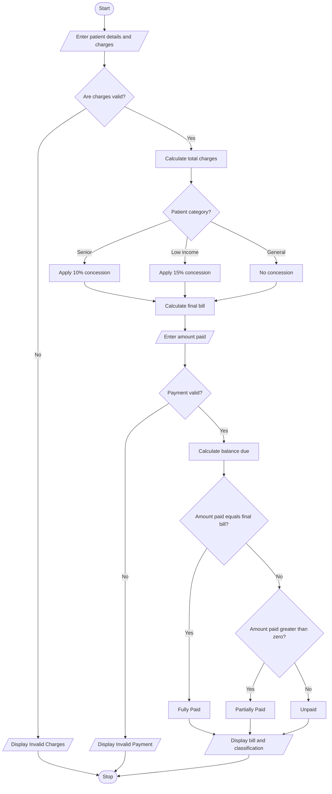

# 1. Problem Statement
To develop a program that calculates a patient's hospital bill by adding consultation, diagnostic, and treatment charges. Apply eligible concessions based on hospital policy, validate billing constraints, calculate the final amount, and classify patients according to the supplied payment policy.
# 2. Algorithm
1. Start.
2. Enter patient ID, name, and patient category.
3. Input consultation, diagnostic, and treatment charges.
4. Validate that all charges are non-negative.
5. Calculate the total bill by adding all charges.
6. Check whether the patient is eligible for a concession.
7. Calculate the concession and subtract it from the total bill.
8. Validate the final bill amount.
9. Classify the patient according to the payment policy:
   - Paid in full — Fully Paid
   - Partially paid — Partially Paid
   - No payment — Unpaid
10. Display the patient details, total charges, concession, final bill, amount paid, and payment classification.
11. Stop.
# 3. Flowchart (Mermaid)  

# 4. Source Code (C)

#include <stdio.h>

int main() {
    char id[20], name[50];
    int category;
    float consultation, diagnostic, treatment;
    float total, concession = 0, rate = 0;
    float finalBill, paid, balance;

    printf("Enter patient ID: ");
    scanf("%19s", id);

    printf("Enter patient name: ");
    scanf("%49s", name);

    printf("Category (1=General, 2=Senior, 3=Low-income): ");
    scanf("%d", &category);

    printf("Consultation charge: ");
    scanf("%f", &consultation);

    printf("Diagnostic charge: ");
    scanf("%f", &diagnostic);

    printf("Treatment charge: ");
    scanf("%f", &treatment);

    if (category < 1 || category > 3 ||
        consultation < 0 || diagnostic < 0 ||
        treatment < 0) {
        printf("Invalid category or charges.\n");
        return 1;
    }

    total = consultation + diagnostic + treatment;

    if (category == 2)
        rate = 0.10;
    else if (category == 3)
        rate = 0.15;

    concession = total * rate;
    finalBill = total - concession;

    printf("Amount paid: ");
    scanf("%f", &paid);

    if (paid < 0 || paid > finalBill) {
        printf("Invalid payment amount.\n");
        return 1;
    }

    balance = finalBill - paid;

    printf("\n--- BILL SUMMARY ---\n");
    printf("Patient ID: %s\n", id);
    printf("Patient Name: %s\n", name);
    printf("Total Charges: Rs. %.2f\n", total);
    printf("Concession: Rs. %.2f\n", concession);
    printf("Final Bill: Rs. %.2f\n", finalBill);
    printf("Amount Paid: Rs. %.2f\n", paid);
    printf("Balance Due: Rs. %.2f\n", balance);

    if (category == 1)
        printf("Category: General\n");
    else if (category == 2)
        printf("Category: Senior\n");
    else
        printf("Category: Low-income\n");

    if (paid == finalBill)
        printf("Payment Status: FULLY PAID\n");
    else if (paid > 0)
        printf("Payment Status: PARTIALLY PAID\n");
    else
        printf("Payment Status: UNPAID\n");

    return 0;
}
# 5. Sample Input
Enter patient ID: P101
Enter patient name: Ravi
Category (1=General, 2=Senior, 3=Low-income): 2
Consultation charge: 500
Diagnostic charge: 1200
Treatment charge: 3000
Amount paid: 3000
# 6. Sample Output
--- BILL SUMMARY ---
Patient ID: P101
Patient Name: Ravi
Total Charges: Rs. 4700.00
Concession: Rs. 470.00
Final Bill: Rs. 4230.00
Amount Paid: Rs. 3000.00
Balance Due: Rs. 1230.00
Category: Senior
Payment Status: PARTIALLY PAID
# 7. Screenshot

    
